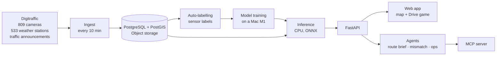

# Keli Live

**Live road conditions from every Finnish road camera, not just where the sensors are.**

Finland has 809 public road cameras, but only about 1 in 5 has a road-surface sensor next to it. Keli Live learns from the cameras that do and reads road conditions (dry, wet, slush, snow, ice risk) from the images of all the others. The map updates every 10 minutes, and an AI assistant explains the risk on your route in plain language.

> *Keli* is Finnish for road and driving conditions.

| | |
|---|---|
| **Live demo** | _coming soon_ |
| **90-second video** | _coming soon_ |
| **Status** | In active development, winter 2026–27 · see [Project Timeline](docs/Project_Timeline.md) |


<!-- replace with a real screenshot after the first deployment -->

---

## Why it matters

- Road-surface sensors are precise but sparse. Measured on 23 Nov 2026, **only about 20% of collecting cameras have a sensor within 0.5 km**, and **57% have none within 2 km**.
- Black ice and slush form where conditions *change*, and nobody watches 2,282 camera angles every 10 minutes.
- Forecasts can miss a cold front. Keli Live raises an alert when **the cameras disagree with the forecast**.

## What it does

| Feature | What you get |
|---|---|
| **Live condition map** | Every camera coloured by road condition, refreshed every 10 minutes |
| **Sensor + AI fusion** | A filled marker means a roadside sensor confirms the reading. A ring means the camera model is reading the image alone |
| **Ice-risk logic** | Unsalted wet surface at or below 0 °C, frost or alarm warnings, low friction (salted wet roads are not flagged on temperature alone) |
| **Driving hazard** | High / Caution / Low with the reasons, from sensor rules only: ice, frost forming now, low grip, snow or rain on a frozen road, "may freeze within the hour" |
| **How long it has lasted** | "Icy for 2 h 10 min, was wet", honest about data gaps ("for at least…") |
| **Winter maintenance** | "Salted 25 min ago, 4 m from the camera" and a map layer of recent salting, sanding and ploughing tracks |
| **Road weather forecast** | Fintraffic's forecast for the camera's road section: now, +2, +4, +6 and +12 h |
| **Time travel** | Scrub back through the last 24 hours |
| **Live fallback** | If the database is down, the API serves Digitraffic's latest data with the same rules |
| **Drive** (a game) | Drive a real road in a car, 4×4, van, race car, bus or lorry on today's real surfaces: ice slides, black-ice patches, real bends. Works offline with the last data loaded |
| **English and Finnish** | Every label, number and date in the chosen language |
| **Forecast-mismatch alerts** (v1.1) | "The forecast said wet, the camera shows ice." A human approves each alert before it is published |
| **AI route brief** | A plain-English summary of conditions along a route, with the worst point named |
| **Accident context** (v1.1) | Fintraffic traffic announcements shown next to the road condition at that spot |

## How it works



1. **Ingest:** camera images, sensor readings, winter-maintenance tracks and road weather forecasts from [Digitraffic](https://www.digitraffic.fi/en/) (Fintraffic's open data).
2. **Label automatically:** a nearby sensor, a zero-shot image model, simple pixel rules and a small local vision-language model vote on each image. Agreements become training data. Only disagreements reach a human. (v1 uses the sensor labels; the other voters and human review arrive in v1.1.)
3. **Train:** a small vision model on the driving lane, evaluated on **cameras it has never seen**.
4. **Serve:** one FastAPI process serves both the REST API and the web app; CPU inference and agents that explain and alert come next.

Details: [HLD](docs/HLD_Architecture.md) · [LLD](docs/LLD_Architecture.md) · [Technical documentation](docs/Technical_Documentation.md)

## Results

_Filled in after the first evaluation. Numbers here will be measured, never estimated._

| Model | Macro-F1 (unseen cameras) | Ice-risk recall | Notes |
|---|---|---|---|
| Zero-shot baseline (OpenCLIP) | TBD | TBD | No training |
| DINOv2-small + linear probe | TBD | TBD | |
| ConvNeXt-Tiny fine-tuned + road temperature | TBD | TBD | |

Reference point: a New York State DOT study reached [81.5% accuracy on unseen cameras](https://arxiv.org/abs/2510.06440) with about 22,000 hand labels. Keli Live aims for a comparable result with **automatic** labels.

## Quick start

```bash
git clone https://github.com/SaurabhDB/keli-live.git
cd keli-live
python3 -m venv .venv && source .venv/bin/activate
pip install -e ".[dev]"
cp .env.example .env                  # KELI_DATABASE_URL (settings: config/keli.json)
python -m keli.storage.migrate        # PostgreSQL 18 + PostGIS
python -m keli.ingest --once          # one recording cycle
python -m keli.storage.importer       # load it into the database
(cd frontend && npm install && npm run build)
uvicorn keli.api.main:app             # app + API on http://localhost:8000
```

Full setup, training and deployment: [Technical documentation](docs/Technical_Documentation.md).

## Tech stack

Python 3.12 · FastAPI · PostgreSQL 18 + PostGIS · S3-compatible object storage · PyTorch (Apple MPS) · timm · OpenCLIP · DINOv2 · ONNX Runtime · Label Studio · cleanlab · LangGraph · Model Context Protocol (MCP) · Ollama · React + TypeScript + Vite · MapLibre GL · three.js · Docker Compose · GitHub Actions · Hetzner Cloud (EU)

## Privacy and responsible use

- No vehicle tracking, no number-plate reading, no counting of individual vehicles.
- Only lane crops and thumbnails are stored. Full images are kept privately for training and are never republished.
- Every condition shown carries its source (sensor or model) and confidence. "Image unusable" is shown honestly instead of a guess.
- Keli Live is a demonstration project. It is not an official road-condition service: always follow Fintraffic's and the authorities' warnings.

## Data and licence

- Data: **Source: Fintraffic / digitraffic.fi, license CC BY 4.0.**
- Map: © [OpenStreetMap](https://www.openstreetmap.org/copyright) contributors; basemaps by CARTO and OpenFreeMap.
- 3D vehicles: [Kenney Car Kit](https://kenney.nl/assets/car-kit) (CC0); the bus and lorry are built in code.
- Code: MIT License (see `LICENSE`).

## Roadmap

- [x] Feasibility: data access, sensor decoding, camera-to-station pairing (23 Nov 2026)
- [x] UI prototype with live Helsinki cameras
- [x] Recorder (images, sensors, maintenance, forecasts), PostGIS database and importer
- [x] Sensor labels and rule-based driving hazard
- [x] Map on real data: React app, EN/FI, time travel, live fallback, Drive game
- [ ] Recorder running 24/7 on a server (Render or Hetzner)
- [ ] Database and API tests (coverage gate)
- [ ] Go/no-go: image models vs nearest station (15 Dec 2026)
- [ ] Baseline and main model, evaluated on unseen cameras against the nearest-station baseline
- [ ] Route-brief agent + evaluation
- [ ] Public demo + video (v1, 24 Jan 2027)
- [ ] v1.1: mismatch alerts, MCP server, accidents layer, ops agent, replay, fusion, more labelling voters
- [ ] Sweden (Trafikverket) and Norway (Statens vegvesen)

## Author

**Saurabh Bhadane**, Senior Applied AI Engineer. Built as an independent open-source project.
[LinkedIn](https://www.linkedin.com/in/<your-handle>) · [Email](mailto:<your-email>)

What this project demonstrates: [SKILLS.md](SKILLS.md)
