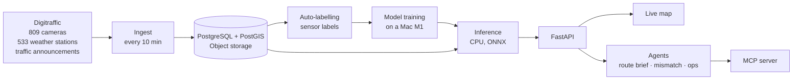

# Keli Live

**Live road conditions from every Finnish road camera, not just where the sensors are.**

Finland has 809 public road cameras, but only about 1 in 5 has a road-surface sensor next to it. Keli Live learns from the cameras that do and reads road conditions (dry, wet, slush, snow, ice risk) from the images of all the others. The map updates every 10 minutes, and an AI assistant explains the risk on your route in plain language.

> *Keli* is Finnish for road and driving conditions.

| | |
|---|---|
| **Live demo** | _coming soon_ |
| **90-second video** | _coming soon_ |
| **Status** | In active development, winter 2026–27 · see [Project Timeline](docs/Project_Timeline.md) |


<!-- replace with a real screenshot after the first deployment -->

---

## Why it matters

- Road-surface sensors are precise but sparse. Measured on 23 Nov 2026, **only about 20% of collecting cameras have a sensor within 0.5 km**, and **57% have none within 2 km**.
- Black ice and slush form where conditions *change*, and nobody watches 2,282 camera angles every 10 minutes.
- Forecasts can miss a cold front. Keli Live raises an alert when **the cameras disagree with the forecast**.

## What it does

| Feature | What you get |
|---|---|
| **Live condition map** | Every camera coloured by road condition, refreshed every 10 minutes |
| **Sensor + AI fusion** | A filled marker means a roadside sensor confirms the reading. A ring means the camera model is reading the image alone |
| **Ice-risk logic** | Unsalted wet surface at or below 0 °C, frost or alarm warnings, low friction (salted wet roads are not flagged on temperature alone) |
| **Forecast-mismatch alerts** (v1.1) | "The forecast said wet, the camera shows ice." A human approves each alert before it is published |
| **AI route brief** | A plain-English summary of conditions along a route, with the worst point named |
| **Accident context** (v1.1) | Fintraffic traffic announcements shown next to the road condition at that spot |
| **Replay** (v1.1) | Scrub back through the last hours and watch a front move south |

## How it works



1. **Ingest:** camera images, sensor readings and traffic announcements from [Digitraffic](https://www.digitraffic.fi/en/) (Fintraffic's open data).
2. **Label automatically:** a nearby sensor, a zero-shot image model, simple pixel rules and a small local vision-language model vote on each image. Agreements become training data. Only disagreements reach a human. (v1 uses the sensor labels; the other voters and human review arrive in v1.1.)
3. **Train:** a small vision model on the driving lane, evaluated on **cameras it has never seen**.
4. **Serve:** CPU inference, a REST API, a map, and agents that explain and alert.

Details: [HLD](docs/HLD_Architecture.md) · [LLD](docs/LLD_Architecture.md) · [Technical documentation](docs/Technical_Documentation.md)

## Results

_Filled in after the first evaluation. Numbers here will be measured, never estimated._

| Model | Macro-F1 (unseen cameras) | Ice-risk recall | Notes |
|---|---|---|---|
| Zero-shot baseline (OpenCLIP) | TBD | TBD | No training |
| DINOv2-small + linear probe | TBD | TBD | |
| ConvNeXt-Tiny fine-tuned + road temperature | TBD | TBD | |

Reference point: a New York State DOT study reached [81.5% accuracy on unseen cameras](https://arxiv.org/abs/2510.06440) with about 22,000 hand labels. Keli Live aims for a comparable result with **automatic** labels.

## Quick start

```bash
git clone https://github.com/<your-user>/keli-live.git
cd keli-live
python3 -m venv .venv && source .venv/bin/activate
pip install -e ".[dev]"
cp .env.example .env               # set DIGITRAFFIC_USER, database URL
docker compose up -d db            # PostgreSQL + PostGIS
python -m keli.ingest --once       # one ingestion cycle
uvicorn keli.api.main:app --reload # API on http://localhost:8000
cd web && python3 -m http.server 5173  # map on http://localhost:5173
```

Full setup, training and deployment: [Technical documentation](docs/Technical_Documentation.md).

## Tech stack

Python 3.12 · FastAPI · PostgreSQL 16 + PostGIS · S3-compatible object storage · PyTorch (Apple MPS) · timm · OpenCLIP · DINOv2 · ONNX Runtime · Label Studio · cleanlab · LangGraph · Model Context Protocol (MCP) · Ollama · Leaflet + OpenStreetMap · Docker Compose · GitHub Actions · Hetzner Cloud (EU)

## Privacy and responsible use

- No vehicle tracking, no number-plate reading, no counting of individual vehicles.
- Only lane crops and thumbnails are stored. Full images are kept privately for training and are never republished.
- Every condition shown carries its source (sensor or model) and confidence. "Image unusable" is shown honestly instead of a guess.
- Keli Live is a demonstration project. It is not an official road-condition service: always follow Fintraffic's and the authorities' warnings.

## Data and licence

- Data: **Source: Fintraffic / digitraffic.fi, license CC 4.0 BY.**
- Map: © [OpenStreetMap](https://www.openstreetmap.org/copyright) contributors.
- Code: MIT License (see `LICENSE`).

## Roadmap

- [x] Feasibility: data access, sensor decoding, camera-to-station pairing (23 Nov 2026)
- [x] UI prototype with live Helsinki cameras
- [ ] Recorder running 24/7
- [ ] Sensor labels
- [ ] Go/no-go: image models vs nearest station (15 Dec 2026)
- [ ] Baseline and main model, evaluated on unseen cameras against the nearest-station baseline
- [ ] Map on real data
- [ ] Route-brief agent + evaluation
- [ ] Public demo + video (v1, 24 Jan 2027)
- [ ] v1.1: mismatch alerts, MCP server, accidents layer, ops agent, replay, fusion, more labelling voters
- [ ] Sweden (Trafikverket) and Norway (Statens vegvesen)

## Author

**Saurabh Bhadane**, Senior Applied AI Engineer. Built as an independent open-source project.
[LinkedIn](https://www.linkedin.com/in/<your-handle>) · [Email](mailto:<your-email>)

What this project demonstrates: [SKILLS.md](SKILLS.md)
