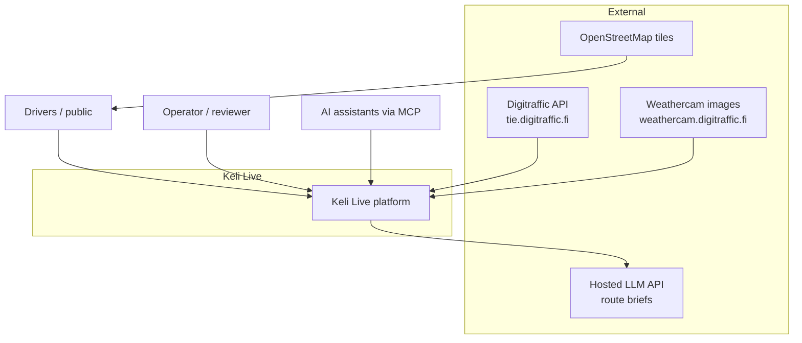
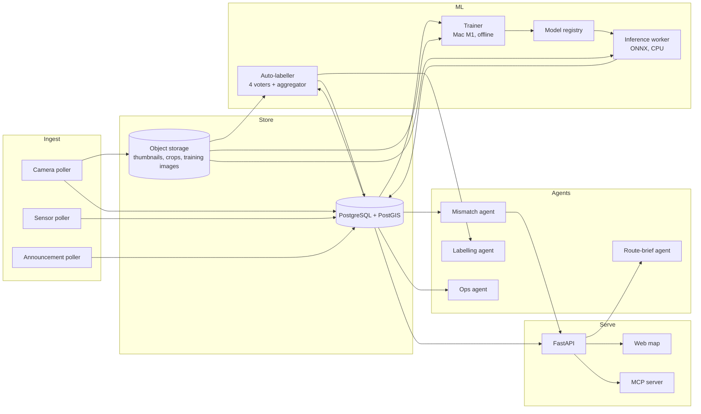
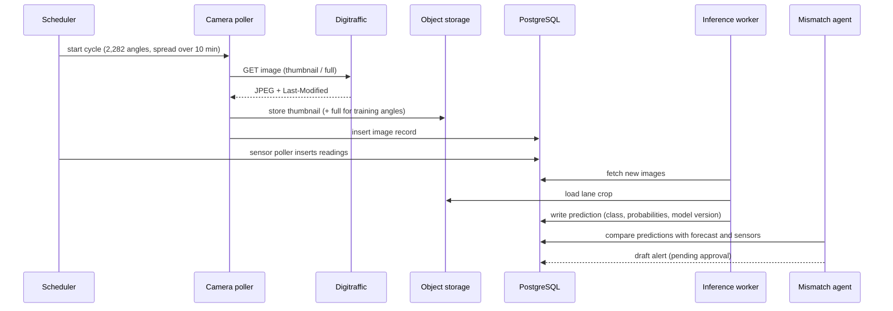

# Keli Live: High-Level Design (HLD)

| | |
|---|---|
| **Version** | 0.1 (draft) |
| **Date** | 23 Nov 2026 |
| **Author** | Saurabh Bhadane |
| **Status** | Approved for build |

## 1. Purpose

Keli Live estimates road-surface conditions for every collecting Finnish road camera, live, and makes them useful to drivers, road crews and businesses. It combines roadside sensors, where they exist, with a computer-vision model where they don't.

## 2. Context

### 2.1 The gap

| Source | Coverage | Limitation |
|---|---|---|
| Fintraffic road weather stations | 533 stations | Readings are for one point; about 20% of cameras have a station within 0.5 km |
| Fintraffic road cameras | 809 cameras, 2,282 angles | Images only; nobody reads them all every 10 minutes |
| Commercial forecasts (e.g. Vaisala Xweather) | National | Forecast, not observation; can miss a front |
| Connected-car friction (e.g. NIRA Dynamics) | Where equipped cars drive | Closed, paid |

**Keli Live fills the gap:** observed conditions at every camera, from images, cross-checked against sensors and forecasts.

### 2.2 Users

| User | Need |
|---|---|
| Driver, commuter | "Is my route slippery right now?" |
| Road-maintenance planner | "Where did conditions change that the forecast missed?" |
| Logistics or delivery operator | Route risk for fleets and couriers |
| Recruiter or hiring manager | A live system to see and a codebase to inspect |

### 2.3 System context

## 3. Requirements

### 3.1 Functional

| ID | Requirement |
|---|---|
| F1 | Ingest camera images, sensor readings and traffic announcements every 10 minutes |
| F2 | Classify each usable camera angle as dry, wet, slush, snow-covered or ice risk; mark unusable images |
| F3 | Show conditions on a map with source (sensor or model) and confidence |
| F4 | Replay the last 24 hours (v1.1) |
| F5 | Detect forecast-vs-observation mismatches and draft alerts for human approval (v1.1) |
| F6 | Produce a plain-language brief for a chosen route |
| F7 | Expose data and tools through a REST API (v1) and an MCP server (v1.1) |
| F8 | Label training data automatically: sensor labels in v1; other voters and human review of disagreements in v1.1 |

### 3.2 Non-functional

| ID | Requirement | Target |
|---|---|---|
| N1 | Freshness: image to map | ≤ 5 minutes after Digitraffic publishes |
| N2 | Availability (demo) | 99% during Dec–Mar |
| N3 | Respect Digitraffic limits | ≤ 1,200 image requests per 5 min (limit 6,000) |
| N4 | Running cost | ≤ €40 a month |
| N5 | Model quality | Macro-F1 ≥ 0.80 on unseen cameras; ice-risk recall ≥ 0.85 |
| N6 | Privacy | No plates, no tracking; lane crops only in any published dataset |
| N7 | Reproducibility | Training runs reproducible from versioned data snapshots |
| N8 | Demo resilience | Works in live mode (v1); replay and offline-sample modes (v1.1) |

## 4. Architecture

### 4.1 Building blocks

### 4.2 Responsibilities

| Component | Responsibility | Runs where |
|---|---|---|
| Camera poller | Fetch the latest image per angle, spread evenly over each 10-minute cycle; store thumbnail; store full image for training angles | Server |
| Sensor poller | Fetch all station data every 10 minutes; validate codes and freshness | Server |
| Announcement poller | Fetch traffic announcements (accidents, closures) | Server |
| Auto-labeller | Combine sensor, zero-shot, pixel-rule and VLM votes into labels | Mac (batch) |
| Trainer | Train and evaluate models; export ONNX | Mac M1 |
| Inference worker | Classify each new image; write predictions | Server, CPU |
| API | Serve conditions, history, alerts, route briefs | Server |
| Web map | Leaflet + OpenStreetMap front end | Static, served by the API host |
| Agents | Route brief (hosted LLM), mismatch (hosted LLM, human approves), labelling and ops (local LLM) | Server / Mac |
| MCP server | Exposes read tools and the route brief to AI assistants | Server |

### 4.3 Core principle

**A deterministic core with agents at the edges.** Ingestion, labelling rules, inference and alert thresholds are ordinary, testable code. LLMs only explain, summarise or draft; they never decide a road condition on their own, and nothing an agent drafts is published without passing rules or human approval.

## 5. Key flows

### 5.1 Live cycle (every 10 minutes)

### 5.2 Training loop (weekly in winter)

1. Snapshot new images and sensor readings.
2. Auto-label with four voters; send disagreements to Label Studio.
3. Clean labels (temporal smoothing, cleanlab).
4. Train candidates on the Mac; evaluate on held-out cameras.
5. Promote a model only if it beats the current one on unseen cameras without lowering ice-risk recall.
6. Export to ONNX, register, deploy.

## 6. Data

| Data | Volume (measured 23 Nov 2026) | Retention |
|---|---|---|
| Thumbnails, all angles | ~6 GB a day | Full winter |
| Full images, ~450 training angles (hourly) | ~2.7 GB a day | Full winter, private |
| Sensor readings | 533 stations × 144 a day | Indefinitely (small) |
| Predictions | ~330,000 a day | Indefinitely (small) |
| Live images fetched for inference | ~82 GB a day | Not stored |

## 7. Deployment

| Environment | Setup |
|---|---|
| Development | Mac M1 16 GB; Docker Compose for PostgreSQL; MPS for training |
| Production | One Hetzner cloud server (4 vCPU / 8 GB, EU) + Hetzner Object Storage; Docker Compose; Caddy for HTTPS |
| CI/CD | GitHub Actions: lint, tests, daily Digitraffic contract test, image build, deploy over SSH |

## 8. Cost

| Item | € a month |
|---|---|
| Server, 4 vCPU / 8 GB | 10–20 |
| IPv4 address | 0.50 |
| Object storage (~1 TB base) | 6.49 |
| Hosted LLM for route briefs and alert drafts | 0–10 |
| Domain | ~1 |
| **Total** | **~18–38** |

Training runs on the Mac; one-off costs are under €20.

## 9. Privacy and security

- **Privacy:** no tracking, no plate reading, lane crops only in published data; full images private; retention limited to the season.
- **Licence:** CC BY 4.0 attribution on every page, API response and dataset.
- **Secrets:** environment variables, never in the repository; GitHub secret scanning on.
- **Abuse:** API rate limited; MCP tools are read-only except the route brief.
- **LLM safety:** prompts get structured data only; outputs are checked against the data (named places and classes must exist); alerts need human approval.

## 10. Risks

| Risk | Likelihood | Impact | Mitigation |
|---|---|---|---|
| Digitraffic API changes | Medium | High | Daily contract test; adapters isolated in `keli/ingest/` |
| Mild winter, few ice images | Medium | Medium | Record from day 1; oversample; use 24 h history endpoint |
| Model fails on unseen cameras | Medium | High | Lane crops, split by camera, fusion with temperature, honest reporting |
| Night images unusable | High | Medium | "Unusable" class; rely on sensors at night |
| Cost overrun from storage | Low | Low | Thumbnails for all, full images only for training angles |
| Live demo down during an interview | Low | High | Replay and offline-sample modes |
| Employment contract conflict | Low | High | Own time and hardware; open source; no commercial use without checking the contract |

## 11. Scope

**v1** (launch 24 Jan 2027): recorder, sensor labels, a baseline model (DINOv2 probe) and a main model (ConvNeXt-Tiny), both compared against the nearest-station baseline, the map, the route-brief agent with its evaluation, and a video. A go/no-go check on 15 Dec 2026 decides whether image models beat the nearest station; see `Project_Timeline.md`.

**v1.1:** forecast-mismatch alerts, MCP server, accidents layer, ops agent, replay and offline-sample modes, fusion model, the other labelling voters and human review.

**Out of scope:** mobile app, push notifications, countries other than Finland, vehicle-mounted cameras, pavement-damage detection.
