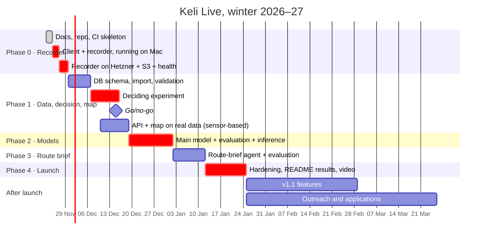

# Keli Live: Project Timeline

| | |
|---|---|
| **Start** | 23 Nov 2026 |
| **Go/no-go check** | 15 Dec 2026 |
| **Public launch (v1)** | 24 Jan 2027 |
| **Live through** | End of March 2027 |
| **Effort assumption** | ~15–20 hours a week (evenings and weekends), building with Claude Code |

## Why these dates

- **The recorder must start now.** Winter images are the training data, and Digitraffic keeps images for only 24 hours. Every day without the recorder is training data that can never be recovered.
- **Decide early (15 Dec)** whether image models beat the nearest sensor, before investing in the main model.
- **Launch in late January**, at peak winter, when the map looks most dramatic and Nordic hiring has restarted after the holidays.
- **Keep it live through March**, so every recruiter who clicks the link sees it working.

## Scope

### v1 (launch, 24 Jan)

1. **Recorder:** thumbnails of every collecting preset every 10 minutes, hourly full images for training presets, all station sensor readings; daily health summary.
2. **Sensor labels:** the sensor voter only (LLD §2.2 mapping, including the salt exception).
3. **Two models, both compared against the nearest-station baseline** on unseen cameras:
   - baseline model: DINOv2-small linear probe;
   - main model: ConvNeXt-Tiny fine-tuned on lane crops.
4. **Map** on real data: sensor-based classes, then model predictions for cameras without sensors.
5. **Route-brief agent with its evaluation:** a fixed set of routes and checks that every place and class in the brief is in the evidence.
6. **Video** (90 seconds).

### Moved to v1.1 (after launch)

Forecast-mismatch alerts and approval flow · MCP server · accidents layer · ops agent · replay and offline-sample modes · sensor + temperature fusion model · zero-shot, pixel-rule and VLM voters, aggregator and Label Studio review · retrain on December–January data.

### v2

Sweden (Trafikverket) and Norway (Statens vegvesen) data.

## Plan at a glance

## Phases

### Status on 27 Nov 2026

- **Done (ahead of plan):** recorder (images, sensors, winter maintenance, road weather forecasts) ran 23–27 Nov on the Mac; PostGIS database + importer; API with live-data fallback; rule-based driving hazard; React map (EN/FI, time travel, maintenance layer, forecasts); "Drive" game; one server for app + API.
- **Recorder paused on 27 Nov** (Mac disk nearly full). Before restarting: move `data/` to the external SSD (`KELI_DATA_DIR`), or move the recorder to a server.
- **Open:** database/API tests (coverage gate), commits and merge to `dev`, hosting (Render or Hetzner), data retention, per-client rate limits.

### Phase 0: Recorder (23–29 Nov)

| Task | Done when |
|---|---|
| Feasibility checks | ✅ Data access, sensor codes, pairing confirmed (23 Nov) |
| UI prototype | ✅ Map with live Helsinki layer |
| Documentation | ✅ README, SKILLS, HLD, LLD, technical docs, timeline; salt exception and v1 scope added (24 Nov) |
| GitHub repo, licence, CI skeleton | Repo public; lint, mypy and pytest run on push |
| Digitraffic client + recorder | Async client with rate limiter (≤ 1,200 requests / 5 min) and retries; tests on recorded fixtures |
| **Recorder running on the Mac** | Started the day it is built; disk watched (~9 GB a day, so the Mac holds only 1–2 weeks) |
| **Recorder on Hetzner** (within 2–3 days) | 4 vCPU / 8 GB server + Object Storage via Docker Compose; `ImageStore` switched from local disk to S3 |
| Health check | Daily summary: images saved, failures, disk used |

**Milestone M0 (29 Nov):** recorder running 24/7 on the server.

### Phase 1: Data, decision and map (30 Nov–18 Dec)

| Task | Done when |
|---|---|
| PostgreSQL + PostGIS schema, migrations | Tables from the LLD exist |
| Import and validation | Recorder output imported; faults and stale readings excluded |
| Daily Digitraffic contract test | Runs in GitHub Actions |
| Lane crops for sensor-adjacent presets | Crops look right on a contact sheet |
| **Deciding experiment** | On daytime lane crops from cameras within 0.5 km of a sensor, split by camera: nearest-station reading (baseline) vs zero-shot (OpenCLIP) vs DINOv2 linear probe. Macro-F1 and ice-risk recall recorded from `keli.models.evaluate` |
| API: health, cameras, conditions, history | Endpoints return real data |
| Map on real data (sensor-based classes) | Prototype switched from dummy data to the API |

**Go/no-go (15 Dec):**

- **Go:** the image models clearly beat the nearest-station baseline on unseen cameras → continue with the main model as planned.
- **No-go:** they do not → change the story to sensor fusion and AI explanation (sensor-backed map, route brief, honest negative result in the README). Revise this timeline the same day.

**Milestone M1 (18 Dec):** public preview of the map with real sensor-based conditions.

### Phase 2: Main model (19 Dec–1 Jan)

| Task | Done when |
|---|---|
| Sensor-labelled training set | Snapshot frozen, split by camera |
| ConvNeXt-Tiny fine-tuned | Compared against the nearest-station baseline and the DINOv2 probe; macro-F1, per-class recall and ice-risk recall reported, day and night separately |
| ONNX export, inference worker | Predictions written every cycle |

**Milestone M2 (1 Jan):** map shows model predictions for cameras without sensors.

### Phase 3: Route brief (2–11 Jan)

| Task | Done when |
|---|---|
| Route-brief agent (hosted LLM, validated) | Briefs for 4 routes, cached; every place and class in the text exists in the evidence |
| Route-brief evaluation | Fixed evaluation set of routes and conditions; pass rate measured and reported |

**Milestone M3 (11 Jan):** v1 feature-complete.

### Phase 4: Launch (12–24 Jan)

| Task | Done when |
|---|---|
| Load and failure tests | Survives a Digitraffic outage gracefully |
| README results, screenshots, model card | Only measured numbers, with snapshot name and date |
| 90-second video | Uploaded to YouTube |
| Launch post | LinkedIn post (English, plus a short Finnish line) |

**Milestone M4 (24 Jan): public launch of v1.**

### After launch (25 Jan–end of March)

- Build v1.1 features (see Scope), most visible first.
- Send tailored applications and cold emails using the project link (Nordea, Nokia, Vaisala, Fintraffic, Wolt and others).
- Weekly short LinkedIn updates on what the map showed that week.
- Write one technical article: sensors as weak supervision for road-condition images.

## Weekly rhythm

| Day | Focus |
|---|---|
| Mon–Thu evenings (2 h) | One task from the current phase |
| Saturday (5–6 h) | Biggest task of the week |
| Sunday (2 h) | Review recorder health, write a short progress note |

## Risks to the schedule

| Risk | Plan |
|---|---|
| Recorder down for a day | Daily health summary; a lost day cannot be recovered, so fixing the recorder beats any other task |
| Mac disk fills before the server is ready | Move to Hetzner within 2–3 days; thumbnails only on the Mac if space runs short |
| A week lost to work or holidays | Route-brief evaluation shrinks to the 4 demo routes; launch date stays |
| Mild December, few ice images | Keep recording; report ice-risk recall honestly with its sample size |
| Image models lose at the go/no-go | Switch the story to sensor fusion and AI explanation (see Phase 1) |
| Model below target | Launch with honest metrics and the sensor-backed map; improvement becomes the v1.1 story |
| Christmas week | Plan only training runs (machine does the work) |

## Definition of done for launch

- [ ] Live link works on desktop and mobile
- [ ] Map and route brief work on real data
- [ ] Both models compared against the nearest-station baseline; results in README
- [ ] Route-brief evaluation results in README
- [ ] README has a screenshot and the video
- [ ] Docs match the code
- [ ] CI green; contract test passing
- [ ] Attribution and privacy notes on every page
